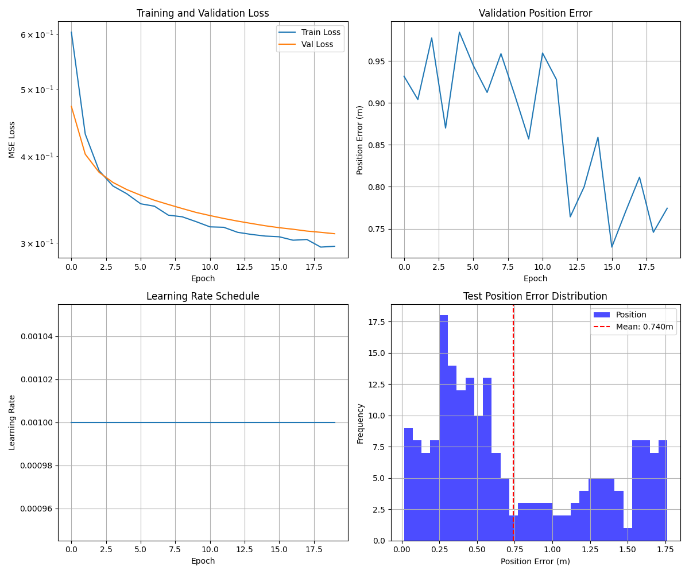
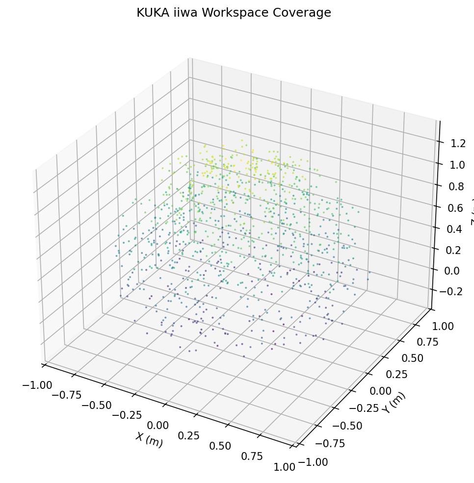
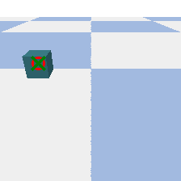
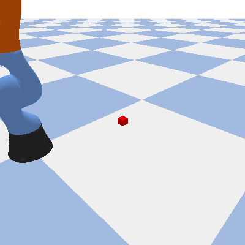
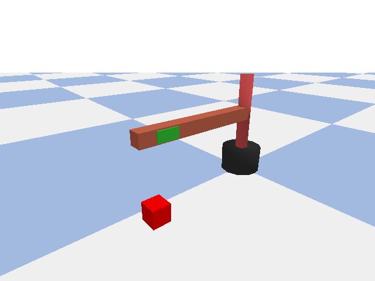
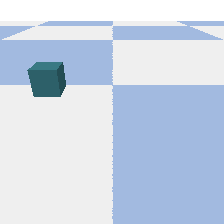

# Robot IK – KUKA inverse kinematics with neural networks

Inverse kinematics (IK) for a KUKA arm simulated in PyBullet. A CNN estimates the cube position from a camera image, and a feed-forward network / KNN model computes the joint angles that reach it.

## Main files

| File | Description |
|---|---|
| `robotv1.ipynb` | Dataset generation, model training (CNN in PyTorch and TensorFlow/Keras) and visualization |
| `IKrobot.ipynb` | Inverse kinematics simulation using the neural networks |
| `kuka.py` | Runs the KUKA robot simulation |
| `Readme.docx` | Original step-by-step instructions |

## How to run

**Step 1 – `robotv1.ipynb`**: dataset creation, model training and visualization. If you already have the dataset, skip the generation cells. Pretrained models are included.

**Step 2 – `IKrobot.ipynb`**: run all cells from the beginning to load the models and start the simulation.

Simulation only: `python kuka.py`

Requirements: `pybullet`, `pybullet_data`, `numpy`, `pandas`, `opencv-python`, `torch`, `Pillow`, `tensorflow`, `matplotlib`, `joblib`.

The dataset is stored in `data_sim/im.zip` (extract it to `data_sim/images/`). Large model files are tracked with Git LFS, so run `git lfs install` and `git lfs pull` after cloning.

## Results

Training history:

KUKA workspace:

Result:

Simulation (`python kuka.py`, the KUKA arm reaching the cube):

Articulated robot:

Sample dataset image:

